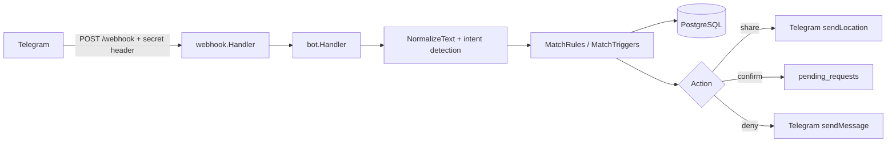

# Always Safe Bot

A Telegram bot written in Go that lets a user decide, through rules, when trusted contacts may receive their location. A trusted contact can ask things like "is she driving?"; the bot matches the message against the owner's rules and either shares the location, asks the owner to confirm, or refuses.

This is a rules-based bot: message handling is text normalisation plus keyword and intent matching. It does not use an LLM or machine-learning model.

## How it works



- `cmd/server`: HTTP server, `/webhook` and `/health`
- `internal/config`: loads `.env` and fails fast if a required variable is missing
- `internal/webhook`: rejects any request that lacks Telegram's secret-token header
- `internal/bot`: update handling, normalisation, intent and rule matching, Telegram API calls
- `internal/db`: repositories for users, trusted contacts, rules, rule actions, locations, contexts and pending requests
- `internal/state`: concurrency-safe conversation flags

## Running locally

```bash
cp .env.example .env      # fill in BOT_TOKEN and TELEGRAM_WEBHOOK_SECRET
go mod download
go run ./cmd/server
```

Telegram must reach the webhook over HTTPS, so expose the port with a tunnel (for example `ngrok http 8080`) and register it:

```bash
curl "https://api.telegram.org/bot$BOT_TOKEN/setWebhook" \
  -d url="https://<your-tunnel>/webhook" \
  -d secret_token="$TELEGRAM_WEBHOOK_SECRET"
```

The database schema is not yet included in this repository; the tables the code expects are `users`, `trusted_contacts`, `rules`, `rule_actions`, `user_locations`, `contexts` and `pending_requests`.

## Tests

```bash
go test ./internal/webhook ./internal/state
```

These cover webhook authentication (correct, missing and wrong secret, non-POST, oversized body) and the concurrent conversation-state set. Rule matching and the database layer are not yet covered.

## Security

- Every webhook request must carry the `X-Telegram-Bot-Api-Secret-Token` header set at `setWebhook` time; it is compared in constant time.
- Request bodies are capped at 1 MB.
- Credentials come from the environment only. `.env` is git-ignored.

## Limitations

- No schema or migrations in the repository yet.
- Conversation flags live in memory, so they reset on restart and do not work across multiple instances.
- Rule matching has no automated tests yet.
